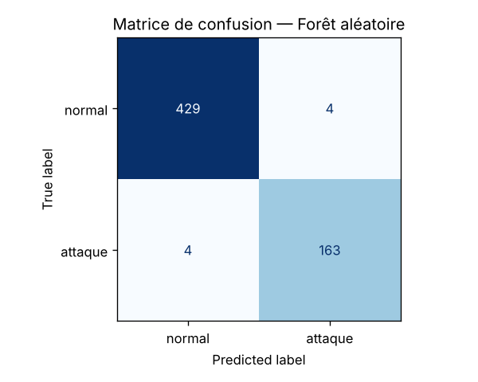

# Projet 2 — Détecter des attaques réseau avec le Machine Learning

**Auteur :** NDOUR Diambogne — L3 Réseaux / Sécurité / IoT

IDS simple : pour chaque flux réseau, le modèle prédit **normal (0)** ou **attaque (1)**
(scan de ports, force brute SSH/Telnet, DoS).

## Lancer le projet

```bash
pip install -r requirements.txt
python src/train.py      # exploration, comparaison de 4 modèles, sauvegarde de models/model.joblib
python src/predict.py    # test rapide de la fonction predict sur data/flux_train.csv
```

Utilisation dans du code :

```python
import pandas as pd
from src.predict import predict
preds = predict(pd.read_csv("nouveaux_flux.csv"))   # liste de 0 / 1
```

## Démarche

1. **Exploration** : 3 000 flux, 10 colonnes ; 90 valeurs manquantes dans `duration` ; 27,8 % d'attaques (833) → classes déséquilibrées, on suit le **F1 de la classe attaque**.
2. **Prétraitement** (dans un `Pipeline` sauvegardé avec le modèle) : imputation par la médiane + `StandardScaler` pour les colonnes numériques, imputation + `OneHotEncoder` pour `protocol`.
3. **Modèles comparés** : régression logistique, arbre de décision, forêt aléatoire, gradient boosting (`class_weight="balanced"` quand c'est possible).
4. **Évaluation** : découpage stratifié 80 % / 20 % (600 flux de validation) + validation croisée stratifiée à 5 plis.
5. **Modèle final** : ré-entraîné sur les 3 000 flux et enregistré dans `models/model.joblib`. Les matrices de confusion sont dans `figures/`, toutes les métriques dans `models/metriques.json`.

---
## Résultats

**Nom / Prénom :** NDOUR Diambogne

Métriques sur le jeu de validation (600 flux, dont 167 attaques) :

| Modèle | F1 (attaque) | Rappel (attaque) | Précision (attaque) | F1 validation croisée (5 plis) |
|---|---|---|---|---|
| Régression logistique | 0,920 | 0,898 | 0,943 | 0,896 ± 0,023 |
| Arbre de décision | 0,943 | 0,940 | 0,946 | 0,928 ± 0,013 |
| **Forêt aléatoire** | **0,976** | **0,976** | **0,976** | **0,958 ± 0,011** |
| Gradient Boosting | 0,973 | 0,970 | 0,976 | 0,953 ± 0,007 |

Matrices de confusion (validation) :

| Modèle | Vrais négatifs | Faux positifs | **Faux négatifs** | Vrais positifs |
|---|---|---|---|---|
| Régression logistique | 424 | 9 | **17** | 150 |
| Arbre de décision | 424 | 9 | **10** | 157 |
| Forêt aléatoire | 429 | 4 | **4** | 163 |
| Gradient Boosting | 429 | 4 | **5** | 162 |



**Modèle retenu et pourquoi :**
La **forêt aléatoire**. Elle a le meilleur F1 sur la validation (0,976) **et** le meilleur F1 moyen en validation croisée (0,958), ce qui montre qu'elle généralise bien et pas seulement sur un découpage chanceux. C'est aussi elle qui rate le moins d'attaques (4 faux négatifs contre 17 pour la régression logistique). La régression logistique est limitée car les attaques ne se séparent pas par une simple frontière linéaire : un scan se reconnaît à la combinaison « beaucoup de connexions vers le même hôte + taux de SYN élevé + peu d'octets reçus », une force brute à « port 22/23 + échecs de connexion ». Les arbres capturent ces règles combinées ; la forêt (300 arbres) réduit en plus le sur-apprentissage d'un arbre unique. Le gradient boosting est presque équivalent ; la forêt est gardée pour son F1 légèrement supérieur.

**Analyse des erreurs (faux négatifs / faux positifs) :**
- **Faux négatifs : 4 attaques ratées sur 167 (2,4 %)**. Ce sont des attaques « discrètes » qui ressemblent à du trafic normal : peu de connexions vers le même hôte (3 à 7), taux de SYN faible (0,04 à 0,32), ports courants (80, 443, 8080, 22). Par exemple une attaque lente sur SSH avec peu de tentatives, que rien ne distingue d'une connexion légitime avec ces seules variables.
- **Faux positifs : 4 flux normaux sur 433 (0,9 %)** pris pour des attaques, par exemple un flux légitime vers un port élevé avec 46 connexions vers le même hôte et un taux de SYN de 0,90 (comportement qui ressemble à un scan), ou des connexions très courtes sur le port 22.
- **Pourquoi le faux négatif est le pire cas en sécurité** : un faux positif coûte une vérification inutile à l'analyste ; un faux négatif est une **attaque qui passe sans alerte**. L'attaquant peut alors poursuivre (vol d'identifiants après une force brute réussie, propagation sur les objets IoT, indisponibilité d'un service par DoS) sans que personne ne réagisse. C'est pour cela que l'on surveille en priorité le **rappel** de la classe attaque, et qu'on pourrait abaisser le seuil de décision (par ex. 0,4 au lieu de 0,5) pour rater encore moins d'attaques, au prix de quelques fausses alertes en plus.

## Structure

```
├── README.md
├── requirements.txt
├── data/flux_train.csv
├── src/train.py
├── src/predict.py
├── models/model.joblib     (+ metriques.json)
└── figures/                (matrices de confusion)
```

Lancement rapide : python src/train.py puis python src/predict.py 
